# Knowledge Graph Index

> Auto-generated by graphify. Start here — read community articles for context, then drill into god nodes for detail.

**130 nodes · 105 edges · 28 communities**

---

## System Architecture Flowchart

```mermaid
flowchart TD
    C0["Template Selector (15 nodes)"]
    C1["Community 1 (11 nodes)"]
    C2["Community 2 (11 nodes)"]
    C3["Community 3 (9 nodes)"]
    C4["Community 4 (9 nodes)"]
    C5["Community 5 (7 nodes)"]
    C6["Community 6 (7 nodes)"]
    C7["Community 7 (7 nodes)"]
    C8["Community 8 (7 nodes)"]
    C9["Community 9 (5 nodes)"]
    C10["Community 10 (4 nodes)"]
    C11["Community 11 (4 nodes)"]
    C12["Metadata Service (3 nodes)"]
    C13["Tab Navigation (3 nodes)"]
    C14["Community 14 (3 nodes)"]
    C15["Community 15 (3 nodes)"]
    C16["Community 16 (3 nodes)"]
    C17["Button styling (3 nodes)"]
    C18["Linting config (2 nodes)"]
    C19["Next.js config (2 nodes)"]
    C20["Configuration Management (2 nodes)"]
    C21["unknown (2 nodes)"]
    C22["Community 22 (2 nodes)"]
    C23["Community 23 (2 nodes)"]
    C24["unknown (1 nodes)"]
    C25["unknown (1 nodes)"]
    C26["unknown (1 nodes)"]
    C27["unknown (1 nodes)"]
```

## Communities
(sorted by size, largest first)

- [[Template Selector]] — 15 nodes
- [[Community 1]] — 11 nodes
- [[Community 2]] — 11 nodes
- [[Community 3]] — 9 nodes
- [[Community 4]] — 9 nodes
- [[Community 5]] — 7 nodes
- [[Community 6]] — 7 nodes
- [[Community 7]] — 7 nodes
- [[Community 8]] — 7 nodes
- [[Community 9]] — 5 nodes
- [[Community 10]] — 4 nodes
- [[Community 11]] — 4 nodes
- [[Metadata Service]] — 3 nodes
- [[Tab Navigation]] — 3 nodes
- [[Community 14]] — 3 nodes
- [[Community 15]] — 3 nodes
- [[Community 16]] — 3 nodes
- [[Button styling]] — 3 nodes
- [[Linting config]] — 2 nodes
- [[Next.js config]] — 2 nodes
- [[Configuration Management]] — 2 nodes
- [[unknown]] — 2 nodes
- [[Community 22]] — 2 nodes
- [[Community 23]] — 2 nodes
- [[unknown]] — 1 nodes
- [[unknown]] — 1 nodes
- [[unknown]] — 1 nodes
- [[unknown]] — 1 nodes

## God Nodes
(most connected concepts — the load-bearing abstractions)

- [[Icon]] — 3 connections
- [[[search, setSearch]]] — 2 connections
- [[filtered]] — 2 connections
- [[ICON_MAP]] — 2 connections
- [[eslintConfig]] — 1 connections
- [[nextConfig]] — 1 connections
- [[config]] — 1 connections
- [[metadata]] — 1 connections
- [[NAV_LINKS]] — 1 connections
- [[FEATURES]] — 1 connections

---

*Generated by [graphify](https://github.com/safishamsi/graphify)*